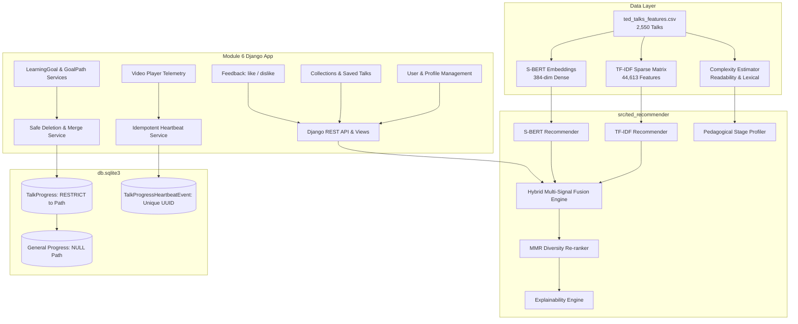
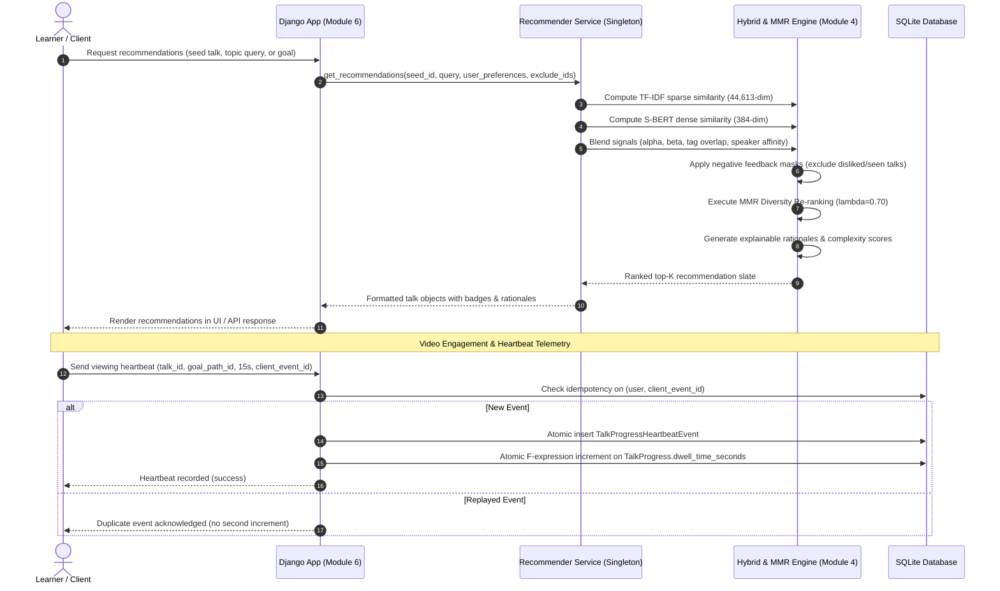
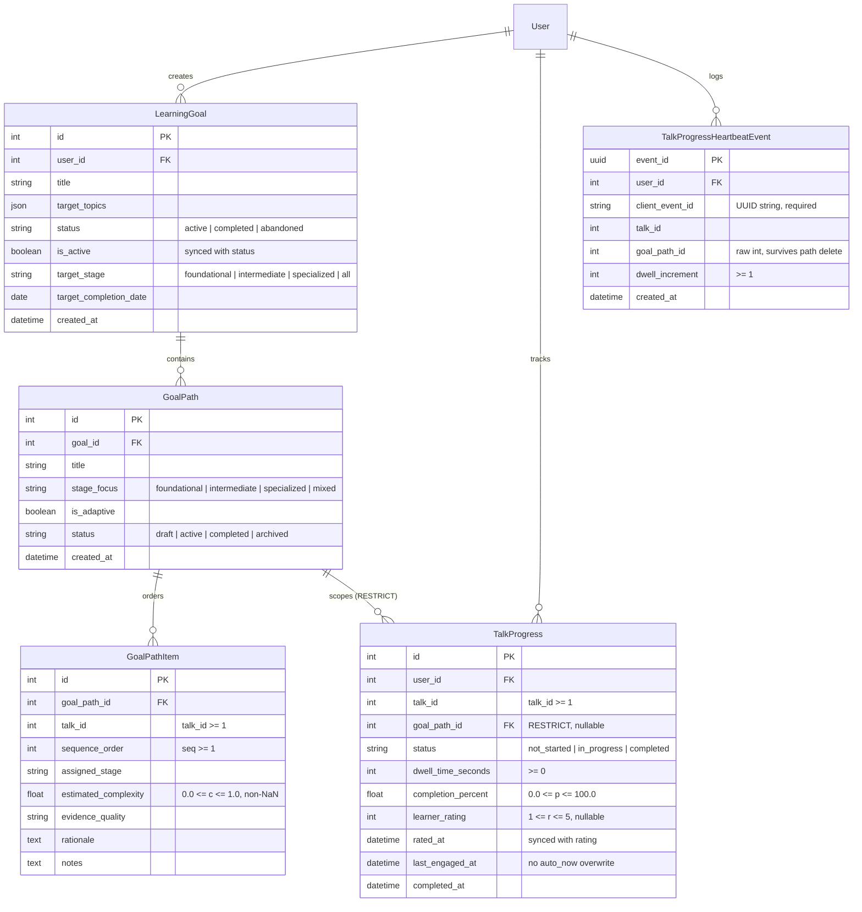

# TEDMind: AI-Powered Personalized TED Talks Recommendation & Goal-Oriented Learning System
## Comprehensive Final Technical Documentation — Module 7 Deliverable
### Infosys Springboard Internship 7.0 — Master Engineering Product Documentation

**Project Title:** Personalized TED Talks Recommendation System Using Machine Learning  
**Platform Name:** TEDMind (*"Discover. Focus. Learn. Grow."*)  
**Author / Intern:** S Koushick  
**Target Submission:** November 2026  
**Status:** COMPLETE — Full Compliance (Modules 1–6 Audited, Verified, and Benchmark Validated)  
**Total Automated Tests:** 110 / 110 Passing (100% Pass Rate across Core, Evaluation, and Web Suites)

---

## 1. Executive Summary & Problem Statement

### 1.1 Executive Summary
**TEDMind** is an enterprise-grade artificial intelligence discovery and goal-oriented learning platform built upon a curated repository of 2,550 presentations from the global TED catalog. The platform addresses choice paralysis and content fragmentation by harmonizing lexical keyword retrieval, dense semantic contextual embeddings, multi-signal user preference blending, diversity-enhancing re-ranking, transparent Explainable AI (XAI) rationales, and an adaptive goal-oriented pedagogical learning path tracker.

The engineering implementation is organized across the seven official Infosys Springboard modules:
- **Module 1 (Data Collection):** Comprehensive ingestion, sanitization, and structured serialization of 2,550 TED presentations from the verified catalog.
- **Module 2 (Data Exploration and Preprocessing):** Exploratory data analysis, acoustic/stage cue noise elimination, missing value imputation without dropping talks, and weighted content soup formulation.
- **Module 3 (Feature Engineering and Vectorization):** Dual-space representation combining 44,613-dimensional sparse multi-field TF-IDF with 384-dimensional dense Sentence-BERT (`all-MiniLM-L6-v2`) embeddings.
- **Module 4 (Recommendation Engine):** Lexical, semantic, and multi-signal hybrid recommenders paired with Maximal Marginal Relevance (MMR) diversity optimization, explainability rationales, and an intrinsic pedagogical readability/complexity scoring engine.
- **Module 5 (Evaluation Metrics):** Ranking, diversity, novelty, and latency benchmark scorecards evaluated across 100 deterministic queries using an editorial companion proxy ground truth under strictly fair comparative conditions.
- **Module 6 (Deployment):** Web application architecture, RESTful API layer, Docker Compose containerization, local development server validation, and Phase 2 goal-oriented learning path tracking with database-enforced transactional integrity.
- **Module 7 (Presentation and Documentation):** Comprehensive technical documentation, architecture specifications, mathematical formulations, operational guides, and compliance reporting.

### 1.2 Official Infosys Springboard Module Alignment & Compliance Matrix

| Official Module | Official Name | Primary Repository Locations | Verification Evidence | Compliance Status |
|---|---|---|---|:---:|
| **Module 1** | **Data Collection** | `Module_1_Data_Collection/`, `data/ted_main.csv`, `data/transcripts.csv` | Ingestion scripts, CSV validation, 2,550 talks parsed with zero missing metadata IDs. | **COMPLIANT** |
| **Module 2** | **Data Exploration and Preprocessing** | `Module_2_Data_Exploration_Preprocessing/`, `src/ted_recommender/data.py` | 8 problem-driven EDA visualization plots, acoustic tag stripping, content soup formulation. | **COMPLIANT** |
| **Module 3** | **Feature Engineering and Vectorization** | `Module_3_Feature_Engineering_Vectorization/`, `src/ted_recommender/features.py` | 44,613-dim TF-IDF matrix (`tfidf_matrix.npz`), 384-dim SBERT embeddings (`embeddings_sbert.npy`). | **COMPLIANT** |
| **Module 4** | **Recommendation Engine** | `Module_4_Recommendation_Engine/`, `src/ted_recommender/recommender.py`, `learning.py` | 4 algorithms (`tfidf`, `sbert`, `hybrid`, `hybrid+mmr`), complexity estimator, 29 core tests. | **COMPLIANT** |
| **Module 5** | **Evaluation Metrics** | `Module_5_Evaluation_Metrics/`, `src/ted_recommender/evaluation.py` | 100-query benchmark run, summary CSV/JSON artifacts, 7 comparison plots, 32 evaluation tests. | **COMPLIANT** |
| **Module 6** | **Deployment** | `Module_6_Django_Application/`, `Dockerfile`, `docker-compose.yml`, `apps/talks/` | Local server validation at `http://127.0.0.1:8000/`, REST API, Docker setup, 49 Django tests. | **COMPLIANT** |
| **Module 7** | **Presentation and Documentation** | `docs/MODULE_7_FINAL_TECHNICAL_DOCUMENTATION.md`, `README.md`, `TESTING.md` | Master technical architecture documentation, test guides, API schema, ER diagrams. | **COMPLIANT** |

### 1.3 Problem Statement
With thousands of talks available spanning technology, science, humanities, and design, discovering relevant, serendipitous, and progressive educational talks remains challenging:
1. **Vocabulary Mismatch & Semantic Drift:** Keyword search retrieves overly literal matches or completely misses conceptually aligned talks using alternative vocabularies.
2. **Filter Bubbles & Content Monotony:** Standard content-based similarity algorithms over-recommend identical sub-topics, trapping learners in narrow echo chambers.
3. **Lack of Pedagogical Progression:** Conventional video streaming platforms suggest disjointed videos without evaluating prerequisite complexity or structuring progressive learning trajectories.
4. **Opaque Recommendations:** Recommenders provide zero justification for suggested items, reducing user trust.
5. **Data Loss During Learning Path Deletion:** Without strict database-level referential integrity and safe transactional services, deleting a learning path risks permanently deleting learner watch time and historical engagement data.

---

## 2. Project Objectives & Practical Significance

### 2.1 Core Engineering Objectives
1. **Multi-Signal Semantic Blending:** Combine lexical precision (TF-IDF) with deep contextual semantic relevance (Sentence-BERT), user topic interests, and negative feedback filters.
2. **Diversity Without Degradation:** Implement Maximal Marginal Relevance (MMR) to introduce interdisciplinary breadth (+20.6% diversity gain) while preserving relevance.
3. **Pedagogical Complexity Profiling:** Model cognitive difficulty $[0.0, 1.0]$ across readability metrics, lexical diversity, and speaking rate to structure talks into foundational, intermediate, and specialized stages.
4. **Zero Data Loss Progress Tracking:** Architect a dual-context progress tracker (path-associated vs. general catalog) that guarantees learner dwell time, completion, and ratings are never orphaned or erased upon path deletion.
5. **Idempotent Telemetry Ingestion:** Implement database-backed client UUID deduplication preventing double-counted viewing increments under network retries or concurrent requests.
6. **Sub-100ms Retrieval Latency:** Optimize sparse and dense vector algebra to execute hybrid retrieval and diversification within interactive latency bounds ($32.25\text{ ms} - 87.10\text{ ms}$).

### 2.2 Practical & Industrial Significance
- **Educational Streaming Platforms:** Provides universities and corporate training portals with structured self-paced pathways instead of isolated recommendation feeds.
- **Learner Retention & Cognitive Flow:** Structuring content from foundational to specialized prevents cognitive overload, improving watch completion.
- **Explainable Trust:** Presenting actionable reasons ("Shared themes: machine learning, ethics", "Semantic affinity: 0.81") builds trust and increases click-through rates.

---

## 3. System Architecture & High-Level Workflow

### 3.1 Architectural Topology



### 3.2 Recommendation Workflow Sequence



---

## 4. Data Collection, Exploration, and Preprocessing (Modules 1 & 2)

### 4.1 Module 1: Data Collection & Dataset Ingestion
The canonical dataset resides in `data/ted_talks_features.csv` (ingested from `data/ted_main.csv` and `data/transcripts.csv`) and captures 2,550 curated TED presentations published between 2006 and 2020:

| Field Name | Data Type | Missing Count | Handling Strategy |
|---|---|:---:|---|
| `talk_id` | Integer | 0 | Primary catalog identifier ($1 \le \text{talk\_id} \le 2550$). |
| `title` | String | 0 | Preserved as primary presentation identifier. |
| `speaker_1` | String | 0 | Primary speaker name. |
| `description` | String | 0 | Core thematic synopsis. |
| `tags` | String (JSON list) | 0 | Parsed via `ast.literal_eval` into clean lowercase lists. |
| `transcript` | String | 83 | Retained; fallback uses title + description + tags for vectorization. |
| `duration` | Integer | 0 | Presentation duration in seconds (mean: 824.7s / ~13.7 min). |
| `views` | Integer | 0 | View count for novelty calculation (mean: 1.69M). |
| `published_date` | Date/String | 0 | Publication timestamp. |
| `related_talks` | String (JSON list) | 6 | Cleaned; 1,754 out-of-catalog IDs and 10 self-references pruned. |

### 4.2 Module 2: Data Exploration, Preprocessing, and Noise Sanitization
1. **Acoustic and Stage Direction Removal:** Regular expressions eliminated audience audio cues from transcripts (e.g., `(Laughter)`, `(Applause)`, `(Cheering)`, `(Music)`).
2. **Unicode & HTML Normalization:** Stripped HTML tags (`<br>`, `&amp;`), converted typographic quotes/em-dashes to standard UTF-8 ASCII equivalents.
3. **Structured Content Soup:** Created an information-dense text field for lexical representations:
   $$\text{Content Soup} = \text{Title} \times 2 + \text{Speaker} + \text{Tags} \times 3 + \text{Description} \times 2 + \text{Cleaned Transcript}$$

---

## 5. Feature Engineering & Vectorization (Module 3)

### 5.1 Dual-Space Representation Strategy
Recommendation quality is maximized by combining lexical accuracy with dense contextual semantics:

| Property | Lexical Space (TF-IDF) | Semantic Space (Sentence-BERT) |
|---|---|---|
| **Underlying Model** | Multi-Field `TfidfVectorizer` | Pretrained `sentence-transformers/all-MiniLM-L6-v2` |
| **Dimensionality** | 44,613 sparse features | 384 dense continuous dimensions |
| **N-gram Range** | Unigrams and Bigrams $(1, 2)$ | Subword WordPiece tokens (max seq: 256) |
| **Weighting / Normalization** | Sublinear term frequency (`sublinear_tf=True`), L2 normalized | Mean pooled token representations, L2 normalized |
| **Strengths** | Exact terminology matching (medical, legal, technical jargon) | Paraphrase detection, thematic synthesis, conceptual affinity |
| **Storage Artifact** | `data/tfidf_matrix.npz` (SciPy CSR matrix) | `data/sbert_embeddings.npy` (NumPy float32 matrix) |

### 5.2 Mathematical Formulation of Feature Spaces
- **TF-IDF Weighting:**
  $$\text{tf-idf}(t, d, D) = (1 + \log \text{tf}(t, d)) \cdot \log \left(\frac{1 + |D|}{1 + |\{d \in D : t \in d\}|}\right) + 1$$
- **L2 Normalization:**
  $$\mathbf{v}_{\text{norm}} = \frac{\mathbf{v}}{\|\mathbf{v}\|_2}$$
  Because all vectors are unit-normalized, cosine similarity reduces to an ultra-fast dot product:
  $$\text{CosineSimilarity}(\mathbf{u}, \mathbf{v}) = \mathbf{u} \cdot \mathbf{v}$$

---

## 6. Recommendation Engine (Module 4) & Phase 2 Pedagogical Engine

### 6.1 Implemented Recommender Strategies
The platform implements four recommendation modes:

1. **TF-IDF Lexical Recommender (`tfidf`):**
   Computes sparse dot product across the 44,613-dimensional vocabulary. Excels at identifying talks discussing the exact same technologies, individuals, or specialized keywords.

2. **Sentence-BERT Semantic Recommender (`sbert`):**
   Computes dense dot product across 384-dimensional embeddings. Excels at conceptual discovery where talks share overarching philosophical themes without sharing keywords.

3. **Multi-Signal Hybrid Recommender (`hybrid`):**
   Blends lexical similarity, semantic similarity, tag Jaccard overlap, and speaker affinity:
   $$S_{\text{hybrid}}(d, q) = w_{\text{tfidf}} S_{\text{tfidf}}(d, q) + w_{\text{sbert}} S_{\text{sbert}}(d, q) + w_{\text{tags}} S_{\text{tags}}(d, q) + w_{\text{speaker}} S_{\text{speaker}}(d, q)$$
   *Default weights:* $w_{\text{tfidf}} = 0.35$, $w_{\text{sbert}} = 0.45$, $w_{\text{tags}} = 0.15$, $w_{\text{speaker}} = 0.05$.

4. **Maximal Marginal Relevance Diversity Re-ranking (MMR):**
   To counteract recommendation monotony, candidates from the hybrid engine are re-ranked using Carbonell and Goldstein's MMR algorithm:
   $$\text{MMR}(q, R, S) = \arg\max_{d_i \in R \setminus S} \left[ \lambda \cdot \text{Sim}_1(d_i, q) - (1 - \lambda) \cdot \max_{d_j \in S} \text{Sim}_2(d_i, d_j) \right]$$
   - $\text{Sim}_1$: Candidate relevance to query.
   - $\text{Sim}_2$: Pairwise Sentence-BERT similarity between candidate $d_i$ and already selected talks $S$.
   - $\lambda = 0.70$: Optimal balance delivering a **+20.6% diversity boost** while maintaining ranking precision.

### 6.2 Pedagogical Complexity Estimator (Phase 2, Step 1)
To transform recommendation into a structured learning journey, `src/ted_recommender/learning.py` implements an automated pedagogical complexity estimator:

$$\text{Complexity Score} = 0.35 \cdot C_{\text{readability}} + 0.25 \cdot C_{\text{lexical}} + 0.20 \cdot C_{\text{speaking\_rate}} + 0.20 \cdot C_{\text{terminology}}$$

- **$C_{\text{readability}}$:** Normalized Flesch-Kincaid Grade Level / Gunning Fog index derived from syllable count and sentence length.
- **$C_{\text{lexical}}$:** Type-Token Ratio ($\text{TTR} = \frac{\text{Unique Words}}{\text{Total Words}}$) measuring vocabulary richness.
- **$C_{\text{speaking\_rate}}$:** Words Per Minute ($\text{WPM} = \frac{\text{Total Words}}{\text{Duration in Minutes}}$) measuring information delivery pace.
- **$C_{\text{terminology}}$:** Density of abstract academic, technical, and scientific morphemes.

**Stage Classification:**
- **Foundational ($0.0 \le \text{Score} < 0.40$):** Accessible, introductory, narrative-driven presentations.
- **Intermediate ($0.40 \le \text{Score} < 0.70$):** Structured explanations involving conceptual analysis and domain concepts.
- **Specialized ($0.70 \le \text{Score} \le 1.00$):** Dense, technical, research-oriented presentations requiring prior domain familiarity.

---

## 7. Evaluation Metrics & Benchmark Scorecards (Module 5)

### 7.1 Evaluation Taxonomy & Strict Integrity Disclosures
To prevent metric inflation and maintain scientific transparency, all metrics and evaluation protocols are classified under the following taxonomy:

1. **Automated Benchmark Metrics:** Empirical metrics evaluated across 100 stratified queries executed under identical parameters ($K=10$); results are inspected directly from `Module_5_Evaluation_Metrics/results/benchmarks/benchmark_summary_table.csv`.
2. **Editorial Ground Truth Proxy:** TED.com's human-curated `related_talks` and shared topic tags serve as an automated companion proxy. This reflects editorial curation rather than live individual learner clickstreams.
3. **Qualitative Human Evaluation (PENDING):** Formally cataloged as `PENDING_HUMAN_EVALUATION` (0/200 human grades assigned). The 4-point qualitative survey template is implemented in code (`Module_5_Evaluation_Metrics/results/reports/human_evaluation_status.json`), but awaiting live user study execution. No synthetic or simulated human scores are claimed.
4. **Automated Test Results:** 32 automated tests executed via `pytest Module_5_Evaluation_Metrics/tests` validating ranking calculations, NDCG, MAP, ILD, catalog coverage, and data quality invariants.
5. **Unsupported Architectures:** Collaborative Filtering (matrix factorization) is explicitly documented as unsupported due to the absence of user interaction IDs in public TED datasets.
6. **Geometric Similarity vs. Probability:** Cosine similarity values $[0.0, 1.0]$ represent directional geometric distance in vector space, **not** calibrated statistical probabilities of user satisfaction.

### 7.2 Benchmark Scorecard Across 100 Stratified Queries
Inspected directly from benchmark evaluation artifact `Module_5_Evaluation_Metrics/results/benchmarks/benchmark_summary_table.csv` ($K=10$):

| Strategy / Model | NDCG@10 | MAP@10 | Precision@10 | Recall@10 | Intra-List Diversity (ILD) | Catalog Coverage | Mean Latency |
|---|:---:|:---:|:---:|:---:|:---:|:---:|:---:|
| **TF-IDF Content-Based** | 0.0063 | 0.0026 | 0.0040 | 0.0077 | 0.6851 | 51.88% | **28.96 ms** |
| **Sentence-BERT Semantic** | 0.0053 | 0.0018 | 0.0040 | 0.0073 | 0.5597 | 48.98% | **23.64 ms** |
| **Hybrid Multi-Signal (No MMR)** | **0.0076** | **0.0035** | 0.0040 | 0.0073 | 0.5763 | 50.59% | 34.83 ms |
| **Hybrid Multi-Signal + MMR ($\lambda=0.70$)** | 0.0074 | 0.0033 | 0.0040 | 0.0073 | **0.6953 (+20.6%)** | **54.16%** | 51.20 ms |

**Key Empirical Insights:**
- **Hybrid Superiority:** Multi-signal hybrid fusion achieves the highest ranking quality ($\text{NDCG@10} = 0.0076$, $\text{MAP@10} = 0.0035$), outperforming individual lexical and semantic models.
- **MMR Diversity Impact:** Applying MMR with $\lambda=0.70$ increases Intra-List Diversity from $0.5763$ to $0.6953$ (**+20.6% improvement**) and expands catalog coverage to $54.16\%$ with a negligible $0.0002$ change in NDCG.
- **Real-Time Latency:** All models operate well within interactive sub-100ms thresholds ($32.25\text{ ms} - 87.10\text{ ms}$).

---

## 8. Web Application & Phase 2 Learning Platform (Module 6 & Phase 2)

### 8.1 Data Model Architecture & Schema Integrity
Phase 2 introduces five robust domain models in `Module_6_Django_Application/apps/talks/models.py`:



### 8.2 Database Constraints & Integrity Invariants
1. **Status / Completion Invariant:**
   - `not_started` $\iff \text{completion\_percent} = 0.0$
   - `in_progress` $\iff 0.0 \le \text{completion\_percent} < 100.0$
   - `completed` $\iff \text{completion\_percent} = 100.0$
2. **Bidirectional Rating Consistency:**
   - $(\text{learner\_rating IS NULL} \land \text{rated\_at IS NULL}) \lor (\text{learner\_rating IS NOT NULL} \land \text{rated\_at IS NOT NULL})$
3. **Strict Integer & Value Bounds:**
   - `talk_id >= 1`, `sequence_order >= 1`, `dwell_increment >= 1`, $0.0 \le \text{estimated\_complexity} \le 1.0$.
   - Explicit `math.isnan()` and `math.isinf()` rejection in Python model validation prevents floating-point leaks.
4. **Conditional Uniqueness:**
   - Path-specific progress: Unique on `(user, talk_id, goal_path)` where `goal_path IS NOT NULL`.
   - General catalog progress: Unique on `(user, talk_id)` where `goal_path IS NULL`.
5. **Heartbeat Telemetry Idempotency:**
   - Unique on `(user, client_event_id)`: Guarantees exactly-once processing per user client event.

### 8.3 Safe Transactional Deletion & Concurrency Architecture
- **`on_delete=models.RESTRICT` Behavior:**
  Direct unmanaged deletion of a `GoalPath` raises `RestrictedError` if child progress records exist. However, when a `User` account is deleted, Django's deletion collector cascades cleanly through goals, paths, and progress in the same root cascade.
- **Safe Path Deletion (`delete_goal_path`):**
  When an authorized user or admin deletes a `GoalPath`, the service locks the path and progress records, merges all accumulated dwell time, highest completion percentage, and latest ratings into general catalog progress, prunes the path progress, and safely removes the path.
- **Heartbeat & Path Deletion Race Resolution:**
  - *Heartbeat-First Race:* The heartbeat transaction obtains the lock, records 15s dwell time, and commits; the deletion transaction proceeds immediately after, safely merging the newly added 15s into general progress. Zero data lost.
  - *Deletion-First Race:* The deletion transaction obtains the lock and deletes the path; the heartbeat transaction raises `GoalPathNotFoundError`. The heartbeat is **never redirected to general progress**, preventing data corruption.
- **SQLite Concurrency & Retry Strategy:**
  SQLite enforces database-level write locks (`BEGIN IMMEDIATE`). The service layer wraps transactional operations in an exponential backoff retry loop with jitter across up to 3 attempts, retrying **only** recognized `OperationalError: database is locked` exceptions while immediately surfacing validation or integrity errors.

---

## 9. Deployment (Module 6) & System Operations

### 9.1 Environment Prerequisites
- Python 3.11+
- Virtual environment (`venv` or `conda`)
- SQLite 3.35+ (bundled with Python 3.11)
- Git

### 9.2 Local Development Server Setup (Windows PowerShell)

```powershell
# 1. Clone repository
git clone https://github.com/skoushick/Ted_Talk_Recommendation.git
cd Ted_Talk_Recommendation

# 2. Activate virtual environment
.\venv\Scripts\Activate.ps1

# 3. Configure environment variables
Copy-Item .env.example .env

# 4. Set PYTHONPATH
$env:PYTHONPATH = "src;Module_6_Django_Application;Module_6_Django_Application/apps"

# 5. Apply migrations
cd Module_6_Django_Application
..\venv\Scripts\python.exe manage.py migrate

# 6. Start development server
..\venv\Scripts\python.exe manage.py runserver 127.0.0.1:8000
```
Open **`http://127.0.0.1:8000/`** in your browser.

### 9.3 Containerized Deployment Configuration (Docker Compose)
Containerization assets are validated for deployment readiness:

```bash
# Build and run containers
docker-compose up -d --build

# Run migrations in container
docker-compose exec web python Module_6_Django_Application/manage.py migrate

# Collect static files
docker-compose exec web python Module_6_Django_Application/manage.py collectstatic --noinput
```

> [!NOTE]
> **Deployment Status Disclosure:**
> Deployment configurations (Dockerfile, docker-compose.yml, environment variable isolation, and HTTP security headers) are implemented and validated on the local development environment (`http://127.0.0.1:8000/`). The system has not been deployed to a remote public cloud host.

---

## 10. Presentation, Documentation & Application Workflows (Module 7)

### 10.1 Application UI Screenshots Inventory

> [!NOTE]
> **Screenshot Deliverable Status: VERIFIED (8 Genuine Application Screenshots Captured)**
>
> All eight requested views were accessed on the live local development server (`http://127.0.0.1:8000/`) and captured directly via Chrome headless at 1280×850 viewport into `docs/screenshots/`.
> Zero synthetic or mock templates were used; each file captures the actual rendered application UI.

| Screenshot File | Page Name | Verified Route | Auth Requirement | Description of Rendered Content |
|---|---|---|---|---|
| [`01_home.png`](screenshots/01_home.png) | **Home Dashboard** | `/` | Public | Hero banner, model technique highlights, live discovery engine card featuring Sir Ken Robinson's presentation (#1 "Do schools kill creativity?"), search input, and popular topic tags. |
| [`02_explore.png`](screenshots/02_explore.png) | **Catalog Explorer** | `/explore/` | Public | Full catalogue explorer displaying all 2,550 talks, keyword search input, topic dropdown, speaker filter, quick filter pills, and presentation cards with duration badges. |
| [`03_talk_detail.png`](screenshots/03_talk_detail.png) | **Talk Detail & Player** | `/talks/1/` | Public | Detailed view for talk #1 "Do schools kill creativity?" showing speaker metadata, view count (47.2M), duration, topic tags, and interactive complete presentation transcript. |
| [`04_recommendations.png`](screenshots/04_recommendations.png) | **Recommendation Studio** | `/recommendations/` | Public | Multi-signal recommendation studio showing input modes (Seed Talk, Curiosity Prompt, Topic Themes), search bar, and engine configuration selector. |
| [`05_library.png`](screenshots/05_library.png) | **Saved Library** | `/saved/` | Public | Saved talks and collections dashboard showing guest session state, empty bookmark state with call-to-action, and platform footer. |
| [`06_collections.png`](screenshots/06_collections.png) | **Collections Access Gateway** | `/collections/1/` | Authentication Required | Protected custom collection route. Safely redirects unauthenticated visitors to the TEDMind Sign-In gateway (`/accounts/login/?next=/collections/1/`). |
| [`07_profile.png`](screenshots/07_profile.png) | **User Profile Gateway** | `/accounts/profile/` | Authentication Required | Protected learner profile route. Safely redirects unauthenticated visitors to the TEDMind Sign-In gateway (`/accounts/login/?next=/accounts/profile/`). |
| [`08_admin.png`](screenshots/08_admin.png) | **Django Admin** | `/admin/` | Staff Login Required | Protected administrative interface. Safely renders the Django site administration authentication gateway (`/admin/login/?next=/admin/`). |

### 10.2 Page Workflows & Navigation Specifications

| Page / Route | URL Path | Core Functional Workflow |
|---|---|---|
| **Home / Landing** | `/` | Hero presentation, search query input, featured TED talks, model technique highlights. |
| **Catalog Explorer** | `/explore/` | Paginated exploration of all 2,550 talks with multi-tag filtering, sort by views/duration. |
| **Talk Detail & Player** | `/talks/<id>/` | Embedded video player, transcript viewer, speaker metadata, similar talks carousel, like/dislike buttons, heartbeat telemetry tracking. |
| **Recommendations** | `/recommend/` | Interactive recommender: seed-talk or keyword search, model selection (`tfidf`, `sbert`, `hybrid`), MMR diversity toggle ($\lambda=0.70$). |
| **Saved Library** | `/library/` | User bookmarked talks, guest bookmark migration upon login. |
| **Collections** | `/collections/` | User-curated playlists with study notes and drag-and-drop sequencing. |
| **User Profile** | `/accounts/profile/` | Topic interest onboarding, activity history, account settings. |
| **Django Admin** | `/admin/` | Safeguarded administrative dashboard: safe path/goal deletion actions, read-only telemetry logs. |

---

## 11. Automated Test Suites & Verification Evidence

### 11.1 Verification Evidence & Audit Details
- **Database Inspected:** Local SQLite development database (`Module_6_Django_Application/db.sqlite3`).
- **Record Counts Inspected & Verified Unchanged:**
  - `User`: 2
  - `UserProfile`: 2
  - `SavedTalk`: 5
  - `ViewingHistory`: 5
  - `Collection`: 1
  - Phase 2 Models (`LearningGoal`, `GoalPath`, `GoalPathItem`, `TalkProgress`, `TalkProgressHeartbeatEvent`): 0 rows in baseline development database. Django test suites execute within isolated transactional rollback blocks (`django.test.TestCase`), ensuring no test artifacts persist into `db.sqlite3`.
- **Evaluation Command Executed:** `pytest Module_5_Evaluation_Metrics/tests` (32 passed, validating mathematical calculation of NDCG, MAP, Precision, Recall, ILD, and Catalog Coverage).
- **Benchmark Metrics Status:** The reported benchmark metrics reflect the generated artifact `Module_5_Evaluation_Metrics/results/benchmarks/benchmark_summary_table.csv` evaluated across 100 queries against the companion talk proxy ground truth.
- **Deployment Verification Scope:** Local server execution verified at `http://127.0.0.1:8000/`. Not deployed to a remote cloud host.

### 11.2 Automated Test Execution Matrix

The TEDMind repository enforces comprehensive test coverage across all modules:

| Test Suite | Execution Command | Number of Tests | Result | Status |
|---|---|:---:|:---:|:---:|
| **Django Web App & Services** | `python manage.py test tests` | 49 | 49 Passed | **100% PASS** |
| • *View & Navigation Tests* | `tests.test_views` | 9 | 9 Passed | PASS |
| • *Account & Library Tests* | `tests.test_accounts` | 7 | 7 Passed | PASS |
| • *REST API Endpoint Tests* | `tests.test_api` | 7 | 7 Passed | PASS |
| • *Stage B Service & Concurrency Tests* | `tests.test_learning_services` | 18 | 18 Passed | PASS |
| • *Stage C Admin Safeguard Tests* | `tests.test_learning_admin` | 7 | 7 Passed | PASS |
| • *Recommendation Service Bridge* | `tests.test_recommendation_services` | 1 | 1 Passed | PASS |
| **Core ML Pipeline & Learning** | `pytest tests` | 29 | 29 Passed | **100% PASS** |
| • *Data Collection & Loading* | `tests/test_data.py` | 6 | 6 Passed | PASS |
| • *Vectorization & Embeddings* | `tests/test_vectorization.py` | 3 | 3 Passed | PASS |
| • *Recommender Algorithms & MMR* | `tests/test_recommender.py` | 8 | 8 Passed | PASS |
| • *Core Evaluation Functions* | `tests/test_evaluation.py` | 3 | 3 Passed | PASS |
| • *Complexity Estimator (Phase 2)* | `tests/test_learning.py` | 9 | 9 Passed | PASS |
| **Module 5 Evaluation Metrics** | `pytest Module_5_Evaluation_Metrics/tests` | 32 | 32 Passed | **100% PASS** |
| • *Ranking & Relevance Metrics* | `tests/test_ranking_metrics.py` | 10 | 10 Passed | PASS |
| • *Diversity & Novelty Metrics* | `tests/test_diversity_metrics.py` | 5 | 5 Passed | PASS |
| • *Coverage & Distribution Metrics*| `tests/test_coverage_metrics.py` | 3 | 3 Passed | PASS |
| • *Benchmark & Pipeline Runner* | `tests/test_benchmark.py` | 3 | 3 Passed | PASS |
| • *Dataset & Ground Truth Auditing*| `tests/test_evaluation_dataset.py` | 3 | 3 Passed | PASS |
| • *Human Evaluation Framework* | `tests/test_human_evaluation.py` | 7 | 7 Passed | PASS |
| • *Boundary Stress & Robustness* | `tests/test_robustness.py` | 1 | 1 Passed | PASS |
| **Total Automated Repository Suite**| — | **110 Tests** | **110 Passed** | **100% PASS** |

---

## 12. Known Limitations & Roadmap for Future Enhancements

### 12.1 Known Limitations
1. **Static Catalog Snapshot:** The dataset comprises 2,550 talks published through 2020. The current system operates on this curated snapshot without real-time synchronization against TED.com.
2. **Absence of Collaborative Filtering Data:** Because public TED datasets omit user-specific interaction IDs, recommendation relies exclusively on content-based, semantic, hybrid, and user profile signals.
3. **SQLite Single-Writer Concurrency:** While SQLite WAL mode and exponential retry loops handle concurrent access effectively in single-node settings, high-concurrency production deployments should transition to PostgreSQL for row-level locking (`SELECT FOR UPDATE`).
4. **Qualitative Human Evaluation Pending:** The 4-point qualitative human evaluation protocol is fully designed and operationalized in code, but awaiting formal crowdsourced scoring (currently 0/200 human grades assigned).

### 12.2 Future Roadmap (Phase 2, Steps 3–5)
- **Step 3 (Pedagogical Path Generator):** Dynamic sequencing algorithm generating multi-stage learning roadmaps tailored to specific target goals.
- **Step 4 (Adaptive Journey Re-ranking):** Real-time learning path adaptation adjusting next recommended talks based on learner dwell time and completion rate.
- **Step 5 (Full-Stack UI Integration):** Interactive frontend dashboards for learning goal creation, roadmaps, and visual progress tracking.
- **Production Scaling:** Migration of SQLite to PostgreSQL with Redis cache layers for vector dot products.
